<div align="center">

# 🏔️ F4LEK – T-Echo APRS (SOTA)

**APRS-over-LoRa firmware (433 MHz) for the LilyGO T-Echo / T-Echo Plus, built for SOTA activations,
with its Android companion app over Bluetooth.**

Find your summit in two keystrokes, self-spot it through **APRS2SOTA**, chat over APRS and set up the
whole device from your phone. Or do it all from the T-Echo's own menus, no phone needed.


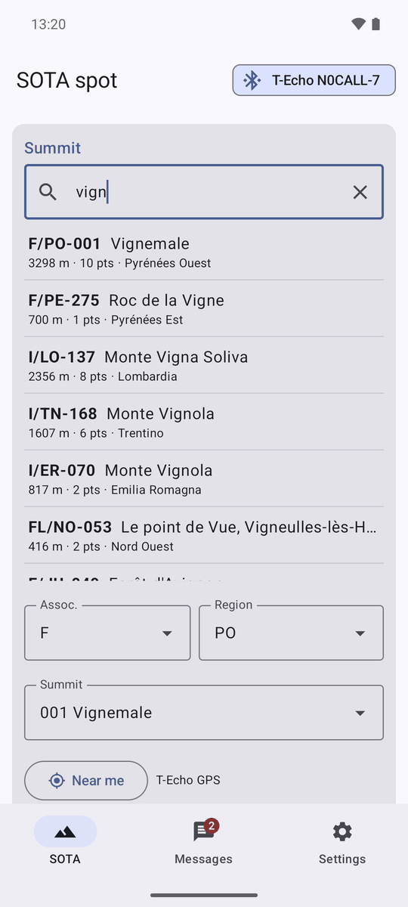 &nbsp;
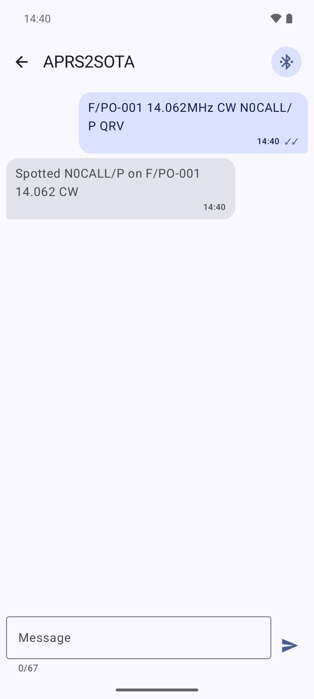 &nbsp;
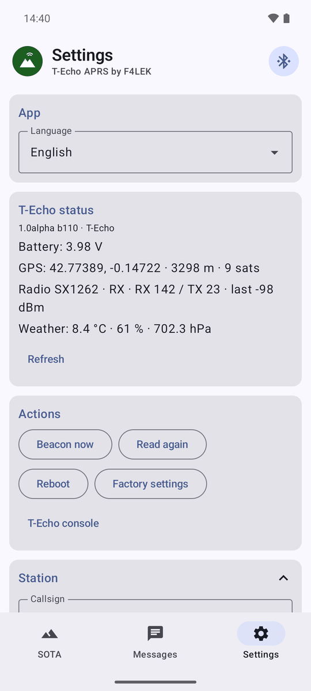

[What it adds](#-what-this-fork-adds) •
[Installation](#-1-installation) •
[Android app](#-2-the-android-app) •
[On the T-Echo](#-3-on-the-t-echo-without-a-phone) •
[Bluetooth](#-4-bluetooth-details) •
[Licence](#-5-licence)

<sub>Prefer a computer and a USB cable? The <a href="https://remy33140.github.io/F4LEK-TECHO-APRS/web/">Kacho web configurator</a> still works.</sub>

</div>

---

## 🙏 Based on EA2OY APRS System

This is a fork of **[EA2OY APRS System](https://github.com/EA2OY/EA2OY-APRS-SYSTEM)**
("Kacho System") by EA2OY. It brings the whole base: LoRa APRS digipeater and tracker,
smart beaconing profiles, telemetry, APRS messaging, flash trip log, the e-paper driver
and the web configurator. All credit for that goes to EA2OY.

## ✨ What this fork adds

| | Feature | What you get |
|:-:|---|---|
| 📱 | **Android app** | SOTA spotting, APRS messaging and full device configuration from your phone. English or French. |
| 📶 | **Bluetooth LE, working** | The T-Echo talks to the phone over Bluetooth: a standard KISS TNC service for the radio traffic and a configuration service for the settings, both protected by a PIN. |
| 🔎 | **Instant summit search** | Every valid SOTA summit (≈172,000) in the app, offline: type `vign` and get F/PO-001 Vignemale, or browse association → region → summit, or list the summits near the T-Echo's GPS position. |
| 💬 | **Messaging, conversation style** | APRS conversations per station, delivery ticks (✓ sent, ✓✓ acknowledged), notifications, and the APRS2SOTA answers. |
| 🗺️ | **SOTA menu on the device** | Plan the activation once (summit, frequency, mode, callsign), then spot it in a couple of clicks with a comment (QRV, QSY, QRT, TEST). |
| 📟 | **SOTA screen** | The plan, the APRS2SOTA status of the last spot and the UTC time for your log. Spots sent from the app update it too. |
| 🔁 | **Leaner carousel** | Home → SOTA → Messages → Stations → Last RX → Last TX. |
| 🇬🇧 | **English UI** | All menus and screens. |

---

## 🔌 1. Installation

### 1.1 Flash the bootloader (S140 7.3.0), once per device

The T-Echo ships with bootloader 0.6.1 + S140 **6.1.1**. This firmware targets
**bootloader 0.11.0 + S140 7.3.0** (applications start at `0x27000`). Every file you
need is in [`bootloader/`](bootloader/). Source and full guide:
[ViezeVingertjes/lilygo-techo-bootloader](https://github.com/ViezeVingertjes/lilygo-techo-bootloader).

1. **Check.** Connect the device to a computer with a USB-C cable. Double-press reset → the
   `TECHOBOOT` drive appears. `INFO_UF2.TXT` should show `s140 6.1.1` and
   `Board-ID: nRF52840-TEcho-v1`.
2. **Flash bootloader + SoftDevice over serial DFU.** Only the `.zip` can change the
   SoftDevice; the `.uf2` files cannot.
   ```bash
   pip install --user adafruit-nrfutil
   adafruit-nrfutil --verbose dfu serial \
     --package bootloader/lilygo_techo_bootloader-0.11.0_s140_7.3.0.zip \
     -p /dev/ttyACM0 -b 115200 --singlebank --touch 1200
   ```
   On Windows, use `-p COMx`. After this the T-Echo has no application and stays in the
   bootloader. That is expected.

> [!WARNING]
> After the upgrade, only flash firmware built for S140 7.x (`0x27000`). An old 6.1.1 build
> (`0x26000`) overwrites the end of the SoftDevice. If that happens, redo step 2.
> To go back to factory, flash LilyGO's `0.6.1_s140_6.1.1` package the same way.

### 1.2 Flash the firmware

Double-press reset and copy
[`firmware/release/F4LEK-TECHO-APRS_v1.0alpha_b112_T-Echo_S140v7.uf2`](firmware/release/F4LEK-TECHO-APRS_v1.0alpha_b112_T-Echo_S140v7.uf2)
onto `TECHOBOOT` (or your own build, see [1.5](#15-build-your-own)).

### 1.3 Turn Bluetooth on

On the T-Echo: **long press** → menu → **Bluetooth** → set **Bluetooth** to **ON**.

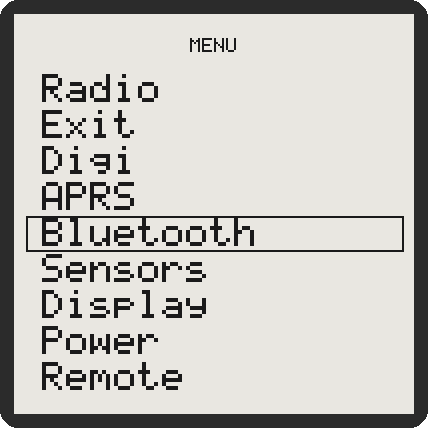 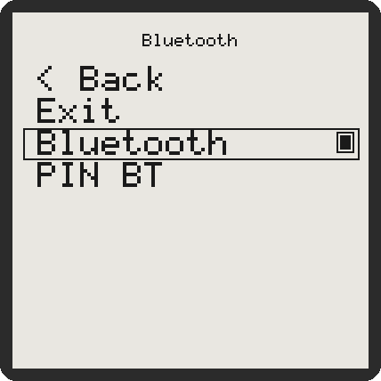

It starts right away, no reboot needed. In the same section, **PIN BT** is the pairing PIN
(6 digits, `123456` by default). Change it if you like: the new PIN applies at the next reboot,
and the phone then has to pair again.

### 1.4 Install the app and connect

1. Install [`android/release/F4LEK-TECHO-APRS-app_v0.1.0.apk`](android/release/F4LEK-TECHO-APRS-app_v0.1.0.apk)
   on an Android 8 to 15 phone (allow installing apps from this source when Android asks).
2. Open it, accept the Bluetooth and notification permissions.
3. Tap **Connect** (top right), pick your **T-Echo &lt;callsign&gt;** in the list.
4. Android asks for the **PIN**: type the T-Echo's PIN (`123456` by default).
5. Go to **Settings** and set at least your **callsign**.

The app reconnects by itself next time, and keeps the link in the background so that messages
still arrive with the screen off.

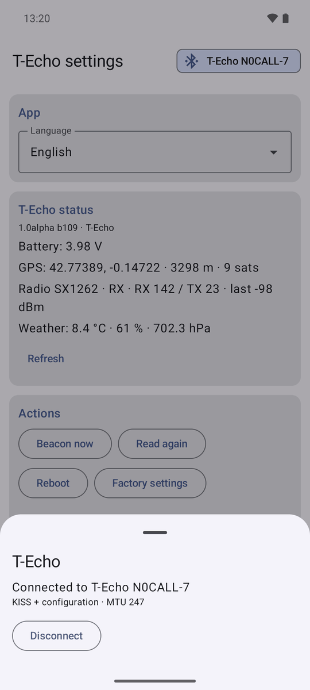

> [!TIP]
> If the app says *KISS only* or cannot read the settings after a firmware update, remove the
> T-Echo from the phone's Bluetooth settings and connect again: Android had kept the old
> firmware's service list.

### 1.5 Build your own

```bash
cd firmware
pio run -e techo_s140v7          # T-Echo
pio run -e techo_plus_s140v7     # T-Echo Plus
```

The UF2 lands in `firmware/.pio/build/<env>/firmware.uf2`.
The app builds with Gradle (JDK 17 + Android SDK 35), see [`android/README.md`](android/README.md).

---

## 📱 2. The Android app

Three tabs: **SOTA**, **Messages**, **Settings**. The Bluetooth icon at the top right shows the
link (tinted when the T-Echo is connected, blinking while it connects); tap it to connect or
disconnect.

### 2.1 SOTA spot

<table>
<tr>
<td width="33%"></td>
<td width="33%">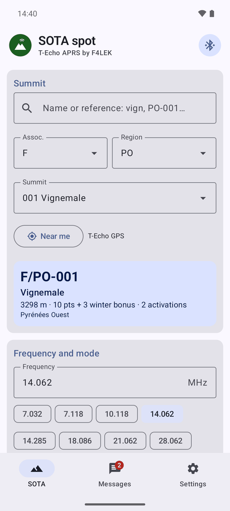</td>
<td width="33%">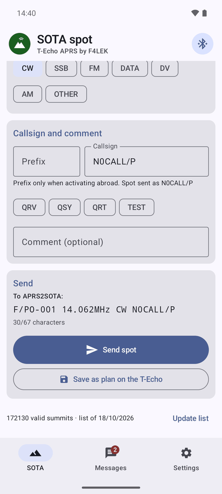</td>
</tr>
<tr>
<td valign="top"><b>Find the summit.</b> Type part of the name or the reference: <code>vign</code>, <code>PO-001</code>, <code>po-1</code>. Accents and case do not matter; summits of your association come first.</td>
<td valign="top"><b>Or browse.</b> Association → Region → Summit, your recent summits, or <b>Near me</b>: the summits within 25 km of the T-Echo's GPS fix. The card shows altitude, points, winter bonus and activations.</td>
<td valign="top"><b>Spot.</b> Frequency (presets or typed), mode, callsign (<code>/P</code> added for you, prefix when abroad) and an optional comment. The exact message is shown before you send it.</td>
</tr>
</table>

**Send spot** hands the message to the T-Echo, which sends it to **APRS2SOTA**, numbers it and repeats
it (after 60 s, then every 120 s) until the gateway acknowledges it. The app then shows the ack and the gateway's answer
(*Spotted*…), and the spot also becomes the activation plan on the T-Echo, so its own **SOTA screen**
shows the same summit, frequency and mode.

> [!NOTE]
> **No ack ≠ no spot.** The spot reaches APRS2SOTA as soon as an iGate hears you, but the ack has
> to come back over the radio, and many LoRa iGates do not transmit. If no ack arrives, check on
> SOTAwatch before sending again.

The summit list ships with the app and **works offline**. **Update list** (bottom of the SOTA tab)
downloads the latest official list from sota.org.uk when you have a connection: do it at home
from time to time, the activation counts and new summits come with it.

### 2.2 Messages

<table>
<tr>
<td width="33%">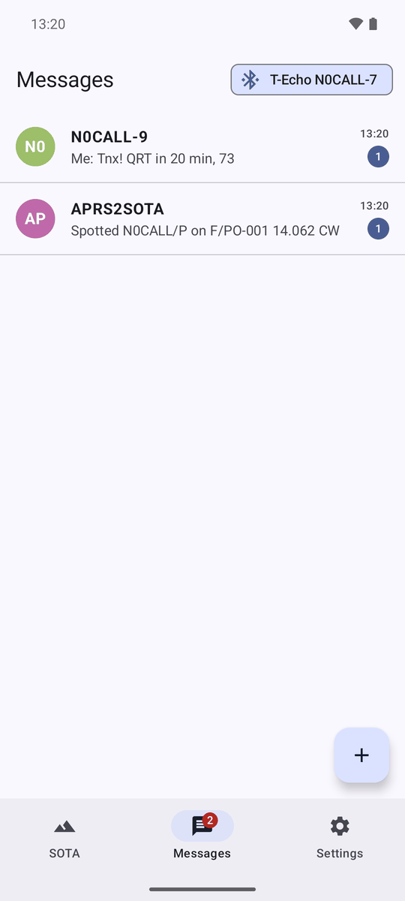</td>
<td width="33%">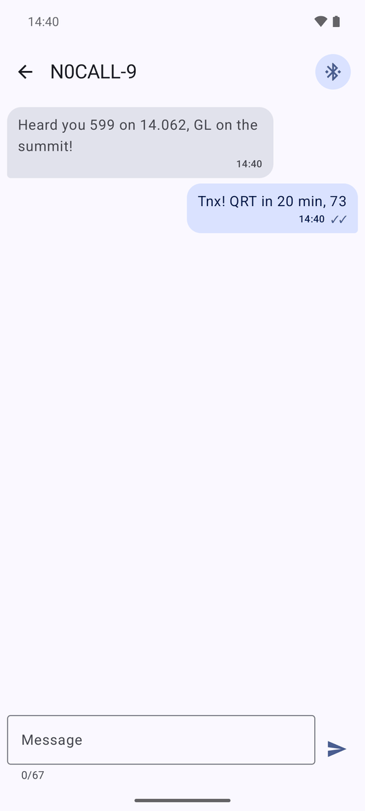</td>
<td width="33%"></td>
</tr>
<tr>
<td valign="top">One conversation per station, unread counters, <b>+</b> to write to a new station (or to APRS2SOTA).</td>
<td valign="top">✓ sent on the air, ✓✓ acknowledged by the other station. Messages are limited to 67 characters, as APRS requires.</td>
<td valign="top">Your spots and the gateway's answers live in the <b>APRS2SOTA</b> conversation.</td>
</tr>
</table>

The T-Echo acknowledges the messages it receives by itself. Messages that come from the Internet
through an iGate (APRS2SOTA, APRSdroid users on APRS-IS…) are handled too.

### 2.3 Settings

<table>
<tr>
<td width="33%"></td>
<td width="33%">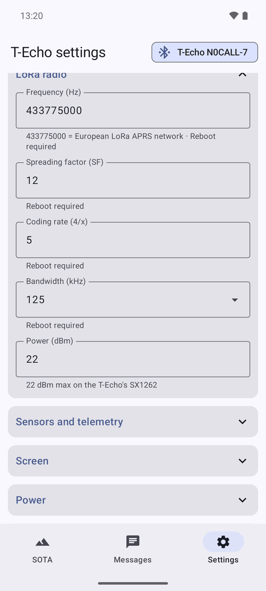</td>
<td width="33%" valign="top">
<b>Status</b>: firmware version, battery, GPS fix, radio counters, weather sensor.<br><br>
<b>Actions</b>: beacon now, read the settings again, reboot, factory settings (callsign and remote
access are kept), and a console for the device's text commands.<br><br>
<b>Every setting of the device</b>, grouped like the web configurator: station, paths, beacons,
tracker and profiles, digipeater, LoRa radio, sensors, screen, power, remote control, Bluetooth.
Values are checked against the firmware's limits before saving; only what changed is sent.<br><br>
<b>Language</b>: English, French or the phone's language (Settings → App).
</td>
</tr>
</table>

### 2.4 Web mode: messages without a T-Echo

For someone at home without a T-Echo (family, a friend) who wants to write to you on yours.
In **Settings → App → Source**, choose **Web (APRS-IS, messages only)**: the app then connects to
the APRS Internet network (APRS-IS) instead of the T-Echo.

<table>
<tr>
<td width="33%">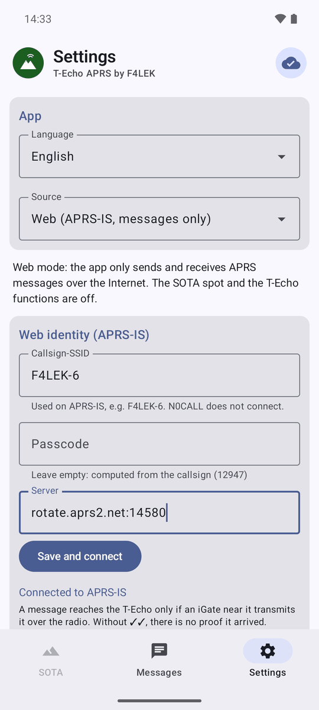</td>
<td width="33%">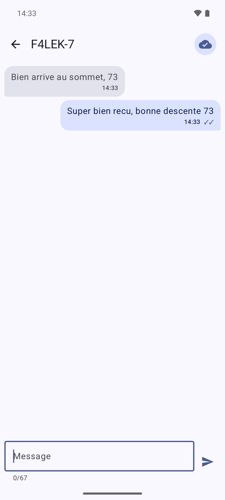</td>
<td width="33%" valign="top">
<b>Set it up once</b>: a callsign-SSID (e.g. <code>F4LEK-6</code>; the default <code>N0CALL-2</code> does
not connect), the passcode is computed from it, the server is <code>rotate.aprs2.net</code>.<br><br>
<b>Messages only</b>: the app opens on Messages, the SOTA tab and the T-Echo settings are greyed
out. The cloud icon at the top right shows the connection.<br><br>
The app is then a station of its own: it numbers its messages, repeats them (60 s, then every
120 s) until they are acknowledged, and acknowledges the messages it receives.
</td>
</tr>
</table>

> [!NOTE]
> A message sent from the Internet reaches the T-Echo only if an iGate that hears the T-Echo
> transmits it back over the radio. Many LoRa iGates only receive: without ✓✓, there is no proof
> the message arrived.

The app identifies itself on APRS-IS as `APZLEK` (an experimental software identifier).

---

## 🗻 3. On the T-Echo, without a phone

Everything SOTA can also be done from the device's own menus. The screens below are the
firmware's own drawing code, rendered on a PC by [`firmware/tools/epd_sim`](firmware/tools/epd_sim).

### Buttons

The T-Echo has two controls: the **touch key** (capacitive pad) and the **physical button**.

| Gesture | On the screens (carousel) | In the menu and the SOTA wizard |
|---|---|---|
| 👆 **Touch key** | next screen | move down the list (wraps around to the top) |
| 🔘 **Short press** | next screen | **enter / confirm** |
| 🔘 **Long press** | **open the menu** | **go back one step** (from the first step: leave) |
| 🔘 **Double press** | send a position beacon | edit a number: decrease it · SOTA wizard: ignored |

> 💡 **Rule of thumb:** touch to *move*, short to *go forward*, long to *go back*.
> Menu and wizard close by themselves after **60 s** without a touch. Nothing gets saved or sent
> if they time out.

### Before your first activation

Set your **callsign** (app, menu or web configurator). The SOTA callsign is built from it:
the SSID is removed and `/P` is added, e.g. `F4LEK-7` → `F4LEK/P`.
If your callsign already has a `/`, it is used as it is.

### Reach the SOTA menu

**Long press** opens the main menu on `Exit`. **Touch twice** → `SOTA`, **short press** to enter.
Then **touch twice** → `Plan activation` (or three times → `SOTA spot`), **short press** to start.

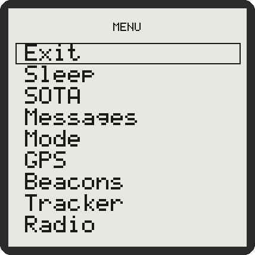 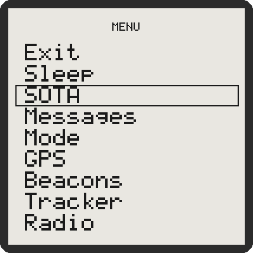 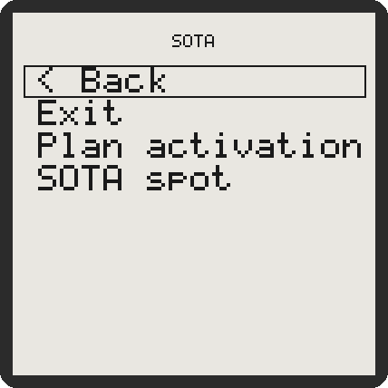 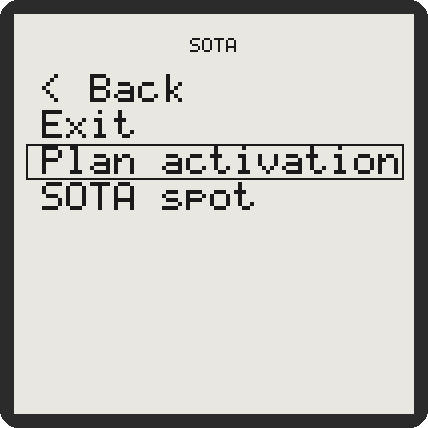

### Plan the activation

Each step shows its title at the top. **Touch** moves the cursor, **short press** validates and goes
to the next step, **long press** goes back one step with your previous choice still selected.

The association list puts shortcuts at the top: **`Re F/PO-001`** reuses your last summit and call
prefix and jumps straight to the frequency (handy for a second band or a QSY), then your recent
associations marked `*`, then the full list.

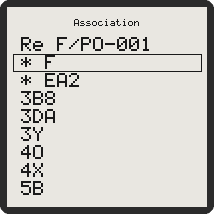 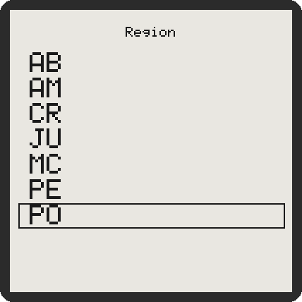 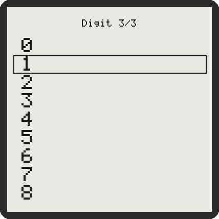 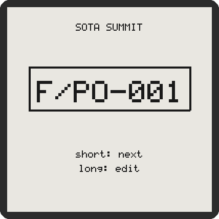

The frequency is entered digit by digit (`014.062` for 14.062 MHz), then the mode and, when you
activate abroad, a call prefix (`(none)` at home). **SAVE PLAN?** shows what will be stored.

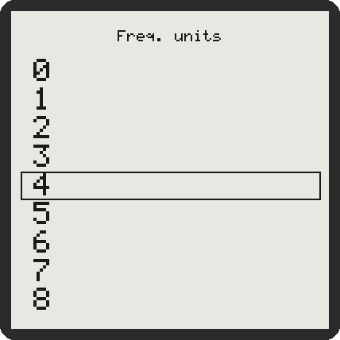 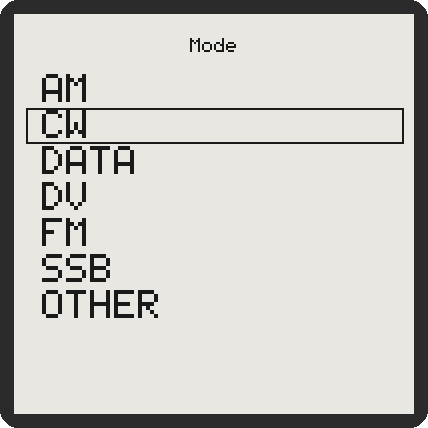 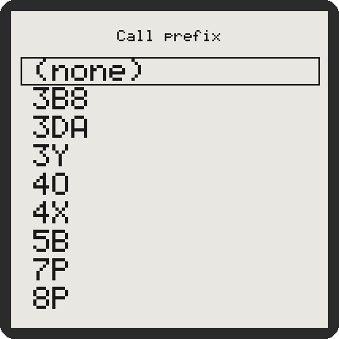 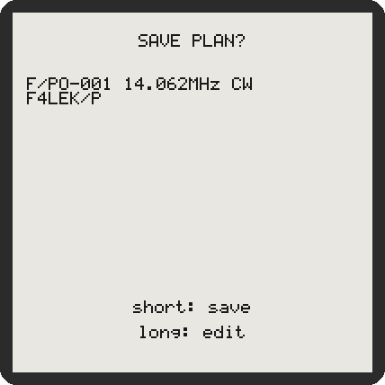

The saved plan stays in flash across reboots and shows on the **SOTA screen** of the carousel.

### Spot from the summit

Open `SOTA spot`, pick a comment (QRV, QSY, QRT, TEST or none), check the message on
**SEND SPOT?** and **short press** to send it to **`APRS2SOTA`**.

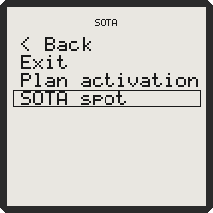 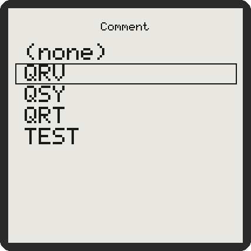 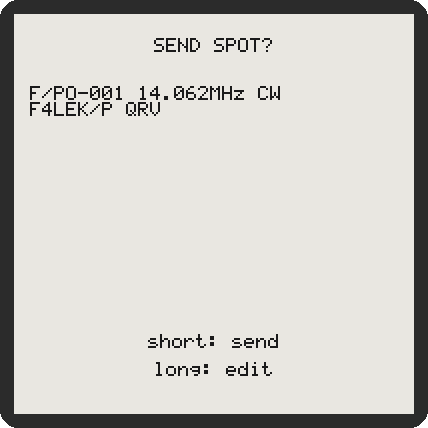 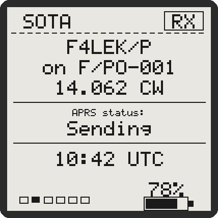

### The SOTA screen

Touch through the carousel until the **SOTA** screen: your callsign, the summit, frequency and mode,
the answer of APRS2SOTA and the UTC time for your log.

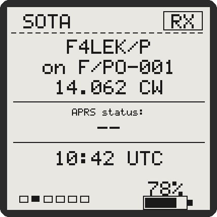  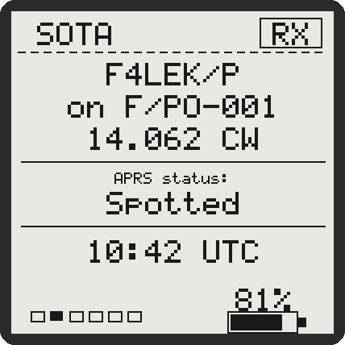

| Status | Meaning | What to do |
|---|---|---|
| `--` | no spot sent since power-on | |
| ⏳ `Sending` | sent, waiting for the gateway's answer | wait. The APRS message is retried automatically. |
| ✅ **`Spotted`** | the spot is published on SOTAwatch | you're on the air |
| ♻️ `Dupe` | that spot already exists | nothing to do |
| ❌ `Error` | the gateway refused it (e.g. unknown mode or summit) | check the plan and send again |
| 📵 `Not sent` | radio error, or no acknowledgement after all retries | no iGate in range: move, or try again later |

The status follows spots sent from the menu **and** from the app. It is kept in RAM only and resets
to `--` after a reboot.

### The carousel

Home (position, speed, altitude, satellites), SOTA, Messages (APRS2SOTA's answers land here too),
heard stations with their distance, last frames received and sent.

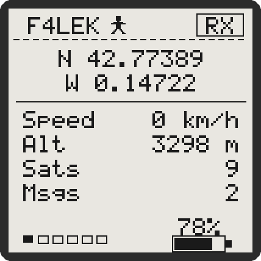 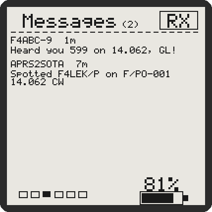 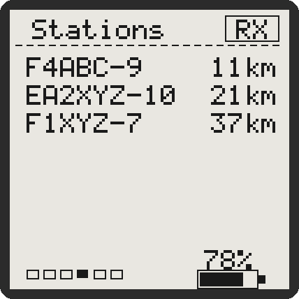 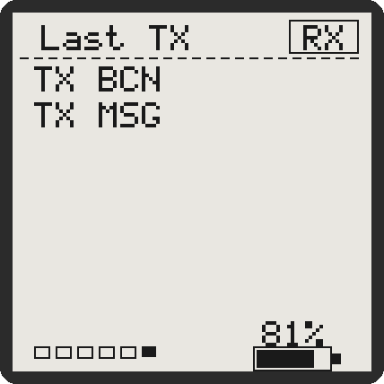

### Other functions

> 📘 For every function that is not SOTA-related (digipeater, tracker, beaconing profiles,
> telemetry, messaging, trip log…), see EA2OY's
> [Kacho System user manual](assets/Manual_Kacho_System.pdf).

---

## 📶 4. Bluetooth details

The T-Echo advertises as **`T-Echo <callsign>`** and offers two GATT services. With a valid PIN,
both require an encrypted, paired link: a phone that has not paired can neither read nor write them.

| Service | UUID | What travels |
|---|---|---|
| **KISS TNC** | `00000001-ba2a-46c9-ae49-01b0961f68bb` (write `…0002`, notify `…0003`) | AX.25 frames in KISS: what you send goes on the air (same mute and listen-before-talk rules as the device), every frame the radio hears comes back. Same UUIDs as other BLE KISS TNCs, so KISS apps can use it. |
| **Configuration** | `f4e40001-7e5c-4b8a-9c1d-2a4f4c454b00` (write `…0002`, notify `…0003`) | The same line protocol as the USB cable (JSON `{"cmd":…}` and text commands), one line per command. Spec: [`firmware/docs/protocol_config_v1.md`](firmware/docs/protocol_config_v1.md). |

Bluetooth and the T-Echo's own beacons coexist: turning Bluetooth on does not silence the device.
The USB cable and the web configurator keep working at the same time.

---

## 📄 5. Licence

GPL-3.0 (see [`LICENSE`](LICENSE)), inherited from EA2OY APRS System, for the firmware and the
Android app. The files in `bootloader/` keep their own licences (MIT, and Nordic's licence for the
SoftDevice). The SOTA summit list is © the SOTA programme (sota.org.uk).

<div align="center"><sub>73 de F4LEK · see you on the summits 🏔️</sub></div>
